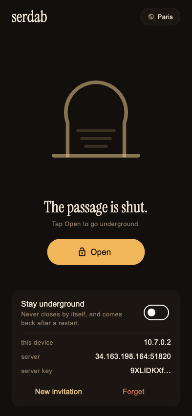
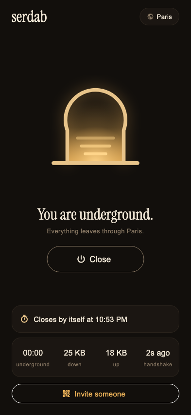
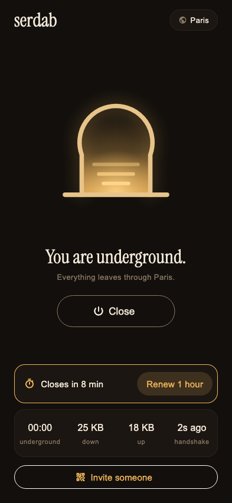
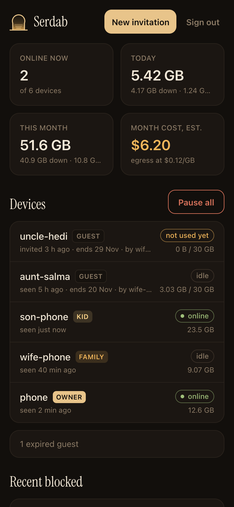

<p align="center"></p>
<h1 align="center">serdab</h1>
<p align="center"><em>Your family's own VPN. One server you own, one app, nobody in between.</em></p>
<p align="center">
  <a href="https://icommit.app"> <b>Powered by iCommit</b></a>
</p>

A **serdab** (سرداب) is the cool underground passage under old houses in the
Maghreb and Iraq: you go down the steps and nobody on the street sees you.
This is that, for a family's phones. One WireGuard server you own, in a city
you pick, an app that opens the door with one tap, and a console that shows you
who is underground and what it costs.

It was built for one test: a parent who has never heard of a VPN gets a message,
taps it, and is through thirty seconds later, in their own language.

```
phones ──WireGuard──▶ your server (Paris, or anywhere) ──▶ the internet
                          │
                          └── serdabd: devices, rules, family filter
                                 ▲
                      your console (web, private network only)
```

<p align="center">




</p>

## Why

Commercial VPNs ask you to trust a "no-logs policy". With serdab the only
machine that sees your traffic is one you rent and can read every line of.
It was made for families who call relatives abroad from a country that blocks
WhatsApp and Messenger calls, and who want a parent's control over who gets in.

## What you get

- **One tap.** Opening the app opens the tunnel. A labelled Open/Close button,
  a door that lights up, and a plain sentence when something is wrong
  ("Another VPN is in the way", "Underground, but no answer").
- **Closes by itself.** Two hours after it opens (a call, then done), so a
  forgotten tunnel does not stream all evening through your server. In the last
  ten minutes a notification offers **Renew 1 hour**; it cannot be renewed
  earlier, so hours never stack. Owner and family devices can stay on instead.
- **Invitations that work in any chat.** An invitation is a normal `https://`
  link that opens the app and sets it up. No accounts, no passwords.
- **Roles.** `owner`, `family`, `kid`, `guest`. Owner and family can invite
  guests from the app. Guests expire three weeks after the invitation (unused
  invitations after 48 hours), have a monthly quota and a speed cap.
  Revoking someone also revokes everyone they invited.
- **Family filter.** Adult and malware sites blocked for filtered devices
  (Cloudflare for Families), with DNS forced through the server so it cannot be
  sidestepped by a DNS setting, DNS-over-HTTPS or iCloud Private Relay.
- **Site history, disclosed.** For devices where you turn it on, the console
  keeps the domains looked up for 30 days. The device's app says the connection
  is monitored. Domains only: never pages, messages or passwords (HTTPS keeps
  those between the phone and the site).
- **The off switch.** Pause everyone but the owner in one tap, disable or revoke
  any device, from the console or the server.
- **English, French, Arabic** (right to left), following the phone.

## What is in the box

| Path | What it is |
|---|---|
| `server/` | `deploy.sh`: one command makes a Debian VM in Google Cloud, a static IP, a firewall rule, installs everything and enrolls your first device. `install.sh` does the same on any Debian 12 box. `serdab`: the server command line. |
| `server/serdabd/` | the service on the server (Python, standard library, SQLite): devices, roles, expiry, quotas, speed caps, the DNS filter, site history, and two small APIs. [docs/api.md](docs/api.md) is the contract. |
| `app/` | the Flutter app for Android and iOS, on the **official** WireGuard engines ([wireguard-android](https://github.com/WireGuard/wireguard-android), [WireGuardKit](https://github.com/WireGuard/wireguard-apple)). |
| `dashboard/` | the console (Next.js): devices, usage and cost, rules, invitations, pause, and the public `/join` page invitations open. |

The app does not invent crypto and talks to nothing but your server. A device's
private key never leaves the phone's Keychain or keystore once it is set up.

## Set it up

### 1. The server (about 5 minutes)

You need the [gcloud CLI](https://cloud.google.com/sdk/docs/install), signed
in, and a Google Cloud project with billing on.

```sh
PROJECT=my-gcp-project ./server/deploy.sh phone
```

It prints a QR and an invitation for your first device, `phone`, as the owner.

```sh
gcloud compute ssh serdab --zone europe-west9-b -- sudo serdab add mom family
gcloud compute ssh serdab --zone europe-west9-b -- sudo serdab list
gcloud compute ssh serdab --zone europe-west9-b -- sudo serdab pause      # everyone but the owner
PROJECT=my-gcp-project ./server/destroy.sh                                 # all gone
```

Another city: `ZONE=europe-west1-b` (Belgium), `ZONE=asia-northeast1-b`
(Tokyo), any zone `gcloud compute zones list` prints. Server settings
(`/etc/serdab/serdabd.env`): `SERDAB_OWNER_NAME`, `SERDAB_TZ` (e.g.
`Europe/Paris`), `SERDAB_COST_PER_GB`, `SERDAB_AUTO_CLOSE_MIN`,
`SERDAB_JOIN_URL` (your console's `/join`).

Not Google? Any Debian 12 box with a public IP works: copy `server/` onto it
and run `sudo ./install.sh`.

**What it costs.** You pay for the machine and for the traffic that leaves it.
On Google Cloud, an `e2-micro` in Paris with its IP is about $11 a month, plus
about $0.12 per GB on the Premium network tier ($0.085 on Standard, with the
first 200 GB a month free). A phone used for calls and browsing is a few GB a
month; streaming video is what costs. A flat-rate VPS (Hetzner, OVH: about
€4 to €5 a month with terabytes included) is far cheaper if the family streams.

### 2. The app

```sh
cd app
flutter pub get
flutter run        # a real phone: VPNs do not run in the iOS simulator
```

**Android** builds as is. For a release APK to hand to people, put a keystore
in `android/key.properties` (git-ignored; see the comment in
`android/app/build.gradle.kts`) and run `flutter build apk --release`.

**iOS**, once:

1. `brew install go` (the WireGuard engine is Go; Xcode compiles it on the fly).
2. A paid Apple developer account. Open `ios/Runner.xcworkspace` and select
   your team on the `Runner` and `SerdabTunnel` targets; Xcode registers the
   Network Extension capability.
3. Your own bundle ids: replace `app.serdabvpn` in `ios/Runner.xcodeproj`,
   `tools/ios_extension.rb` and `ios/Runner/TunnelChannel.swift`.

To run on a phone: turn on Developer Mode (Settings → Privacy & Security) and
build **with the phone selected** (`flutter run -d <id>`). A build without
`-d` makes a provisioning profile that does not list the phone, and iOS
refuses it (error `0xe8008012`).

### 3. The console (optional)

`dashboard/` runs anywhere Node runs. It must reach serdabd's admin API, which
listens only on the server's private address, never on the internet. On
Google Cloud: Cloud Run in the server's region with direct VPC egress;
`dashboard/infra/setup.sh` and `.github/workflows/dashboard.yml` show the
setup (keyless deploys through Workload Identity Federation). Set `SERDAB_TZ`
for local times. You sign in with the key in `/etc/serdab/admin.key` on the
server.

Locally, against fake data: `cd dashboard && npm run mock` in one terminal,
`npm run dev` in another, key `dev-key`.

## Invite someone

From the app (owner and family devices) tap **Invite someone**, type a name,
and send. From the console: **New invitation**. From the server:
`serdab add <name> <role>`.

They get a link like `https://<your console>/join#c=…`. It opens a page with
one button, **Open in Serdab**, that sets the app up. Everything after the `#`
stays in their browser; it is never sent to any server. The link holds the
device's key, so send it to that one person and delete the message.
[docs/family.md](docs/family.md) walks through it for someone who does not do
computers, including getting the app onto their phone.

## How it works, honestly

- **Keys.** The server makes each device's key pair and preshared key, hands
  the private half to the phone inside the invitation, and keeps only what it
  needs. Revoking a device deletes its peer; it cannot connect again.
- **Routing.** The phone sends everything into the tunnel. The server forwards
  it out with one NAT rule. Tunnel traffic can never reach the server's own
  network, the cloud metadata service, or other phones.
- **Identity without passwords.** WireGuard only accepts packets from a peer
  at its own tunnel address, so serdabd knows which device is asking by the
  address alone. The admin API takes a long random key and is reachable only on
  the private network.
- **What the owner can see.** For every device: when it was connected and how
  much it moved. For devices with site history on: domain names and times. No
  one can see the contents of HTTPS traffic, including the owner.
- **Closing by itself.** Android: wake-up alarms and a notification action.
  iOS: the tunnel extension holds the deadline and closes itself, so it works
  with the app not running.
- **Staying on** (owner and family): iOS on-demand rules; Android's own
  *Always-on VPN* setting, which the app links to. Android lets only one app be
  the always-on VPN, and no app may switch another off; serdab detects it and
  sends you to the right setting.

## What it is not

Not anonymous: your server's provider sees the server's traffic, and every site
sees the server's address. Not many countries: one server, one exit. Not a
store app yet: Android installs from the APK, iPhone through Xcode or
TestFlight.

## License

MIT. WireGuard is a registered trademark of Jason A. Donenfeld; the vendored
`app/ios/WireGuardKit` and the Android backend are the WireGuard project's own
code under their licenses (MIT and Apache-2.0).

---

<p align="center">
  <a href="https://icommit.app"></a><br>
  <sub>Built and maintained by <a href="https://icommit.app"><b>iCommit</b></a></sub>
</p>
