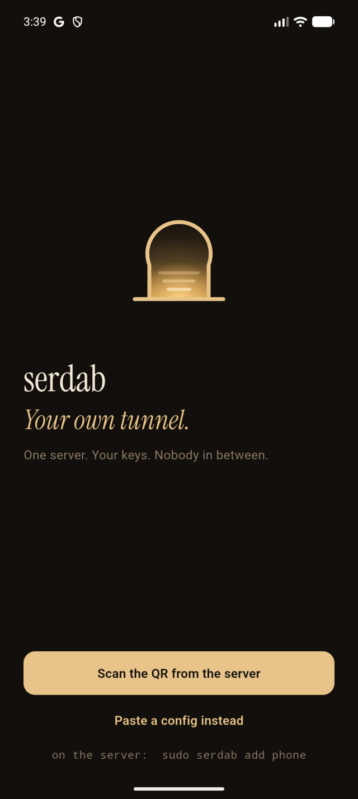
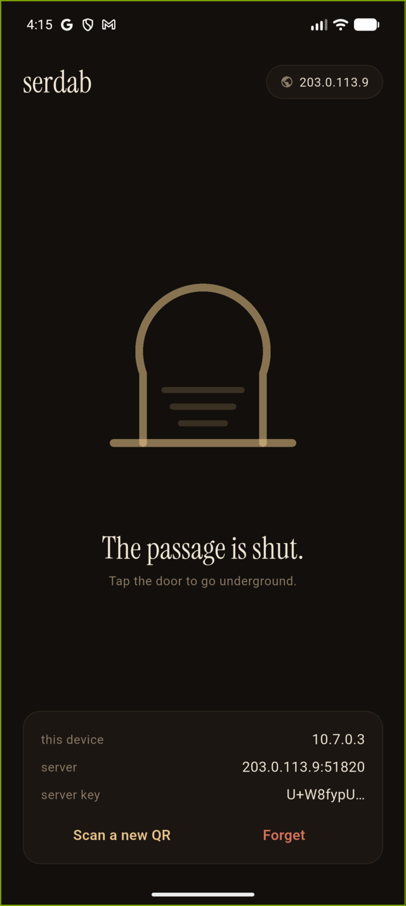
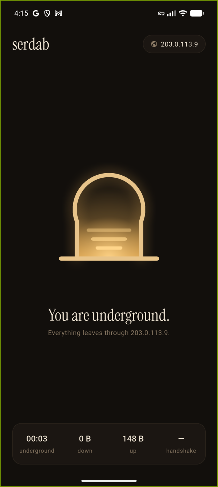
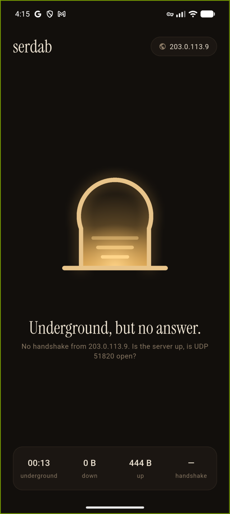

<p align="center"></p>
<h1 align="center">serdab</h1>
<p align="center"><em>Your own tunnel. One server, your keys, nobody in between.</em></p>

A **serdab** (سرداب) is the cool underground passage under old houses in the
Maghreb and Iraq: you go down the steps and nobody on the street sees you.
This is that, for your phone. One WireGuard server you own, in a city you pick,
and an app that opens the door with one tap.

No accounts. No company in the middle. No "no-logs policy" to take on faith:
the only machine that sees your traffic is the one you pay Google seven dollars
a month for, and you can read every line of what runs on it.

```
phone ──WireGuard (UDP 51820)──▶ your VM in Paris ──▶ the internet
```

<p align="center">




</p>

## What is in the box

| Part | What it is | Lines |
|---|---|---|
| `server/deploy.sh` | one command: a Debian VM in Google Cloud Paris, a static IP, a firewall rule, WireGuard installed, your first device enrolled | ~60 |
| `server/serdab` | the server CLI: `add`, `link`, `qr`, `conf`, `rm`, `list` (devices, last handshake, traffic) | ~170 |
| `app/` | the Flutter app, Android and iOS, on the **official** WireGuard engines ([wireguard-android](https://github.com/WireGuard/wireguard-android), [WireGuardKit](https://github.com/WireGuard/wireguard-apple)) | |

The app is a thin door over WireGuard. It does not invent crypto, it does not
talk to anything but your server, and the private key never leaves the phone's
Keychain or keystore.

## 1. The server (5 minutes)

You need the [gcloud CLI](https://cloud.google.com/sdk/docs/install), signed
in, and a Google Cloud project with billing on.

```sh
PROJECT=my-gcp-project ./server/deploy.sh phone
```

That creates everything, then prints a QR and an **invitation link** in the
terminal. Scan the QR with the app if the phone is in the room; send the link in
a chat if it is not (see below).

```sh
# more devices, later
gcloud compute ssh serdab --zone europe-west9-b -- sudo serdab add laptop
gcloud compute ssh serdab --zone europe-west9-b -- sudo serdab link mom   # the invitation again
gcloud compute ssh serdab --zone europe-west9-b -- sudo serdab list

# all gone
PROJECT=my-gcp-project ./server/destroy.sh
```

Another city: `ZONE=europe-west1-b` (Belgium), `ZONE=asia-northeast1-b` (Tokyo),
any zone `gcloud compute zones list` prints. Another port: `PORT=443`.

Not Google? Any Debian 12 box with a public IP works: copy `server/install.sh`
and `server/serdab` onto it and run `sudo ./install.sh`. Hetzner's smallest VM
is about four euros with 20 TB of traffic included, which beats Google's
per-gigabyte egress if you move a lot of data.

**Cost on Google Cloud:** an `e2-micro` in Paris is about $7 a month, plus
roughly $0.09 to $0.12 per GB that leaves the server. Light use lands under $10.

## 2. The app

```sh
cd app
flutter pub get
flutter run        # a real phone: VPNs do not run in the iOS simulator
```

(The icons and the mark come from `docs/logo.py`; rerun it and
`dart run flutter_launcher_icons` only if you change the artwork.)

**Android** builds as is. For a release APK to hand to people, put a keystore
in `android/key.properties` (git-ignored; see the comment in
`android/app/build.gradle.kts`) and run `flutter build apk --release`.

**iOS** needs three things, all once:

1. `brew install go` (the WireGuard engine is Go, Xcode compiles it on the fly).
2. A paid Apple developer account. Open `ios/Runner.xcworkspace`, select your
   team on the `Runner` and `SerdabTunnel` targets. Xcode registers the
   Network Extension capability for you.
3. Your own bundle ids if you are not me: replace `app.serdabvpn` in
   `ios/Runner.xcodeproj`, `tools/ios_extension.rb` and `ios/Runner/TunnelChannel.swift`.

Then, for the phone itself: turn on Developer Mode (Settings → Privacy &
Security), make sure the Apple ID signed into Xcode is the one that owns the
team, and build **with the phone selected** (`flutter run -d <id>` or
`flutter build ios --release -d <id>`). A build without `-d` makes a profile
that does not list your phone and iOS refuses to install it
(error `0xe8008012`).

The extension target was added with `tools/ios_extension.rb`; it is committed,
you do not need to run it again.

Scan the QR, tap the door. The door breathes while the tunnel comes up and
stays lit while you are underground. Tap again to come back up.

## 3. Someone who does not do computers

The test the app is built for: your mother gets one message and is underground
thirty seconds later, in her language, without reading anything.

```sh
gcloud compute ssh serdab --zone europe-west9-b -- sudo serdab add mom
```

prints `serdab://add?c=…&n=mom`, the whole config inside one link. She taps it,
or copies the message and taps **"I was sent an invitation"** in the app. The
phone asks once to allow the VPN. The door lights up. From then on **"Stay
underground"** (on by default) reopens the door by itself: iOS does it with the
system's own on-demand rule, Android when the app launches and after a restart.
The app speaks English, French and Arabic, following the phone.

[docs/family.md](docs/family.md) is the whole procedure, including the honest
part about getting the app onto the phone (APK on Android, TestFlight on iPhone).

WireGuard has no "connected" event: the interface is up the moment you ask,
whether or not the server exists. The only proof the server answered is a
handshake, so the app watches for one and, after eight seconds without it,
says so instead of pretending (the fourth screenshot).

## How it works, honestly

- **Keys.** `serdab add` makes a key pair and a preshared key for the device on
  the server, hands the private half to the phone inside the QR or the
  invitation link, and keeps only the public half. The link is the key: send it
  to one person and delete the message. Revoking a device (`serdab rm`) deletes
  its peer; it cannot connect again.
- **Staying on.** iOS: `isOnDemandEnabled` with a connect-on-any-network rule,
  so the system raises the tunnel, reboot included; a deliberate disconnect
  turns the rule off until the next connect, or iOS would reopen the door at
  once. Android: the config is kept AES-GCM under an Android Keystore key, a
  boot receiver reopens the door if it was open (Android 13+ delivers that
  broadcast to apps minutes late, by design), and the backend's Always-on
  callback answers the system's own *Always-on VPN* setting, which is the
  immediate one; the app links to it.
- **Routing.** The phone sends everything (`0.0.0.0/0, ::/0`) into the tunnel.
  The server NATs it out of its own interface with one nftables rule. IPv6 is
  routed into the tunnel and dropped there, so nothing leaks around it.
- **DNS.** Cloudflare (1.1.1.1) through the tunnel. Change it with
  `SERDAB_DNS` before enrolling, or run your own resolver on the box.
- **MTU.** Google's network MTU is 1460, so the tunnel runs at 1380. If you host
  elsewhere, `SERDAB_MTU=1420` is the usual value.
- **What the app does on each platform.** Android: a `VpnService` from the
  official backend. iOS: a Packet Tunnel network extension running WireGuardKit,
  fed by the app through `NETunnelProviderManager`. Both talk to Dart over one
  method channel with six calls: `prepare`, `connect`, `disconnect`,
  `setAlwaysOn`, `state`, `stats`.

## What it is not

Not a way to hide from your own server's provider, who sees the VM's traffic.
Not a kill switch (yet). Not multi-hop, not many servers, not an account system.
One door, one passage, one exit.

## License

MIT. WireGuard is a registered trademark of Jason A. Donenfeld; the vendored
`app/ios/WireGuardKit` and the Android backend are the WireGuard project's own
code under their licenses (MIT and Apache-2.0).
